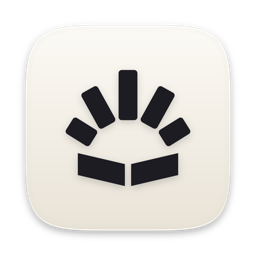
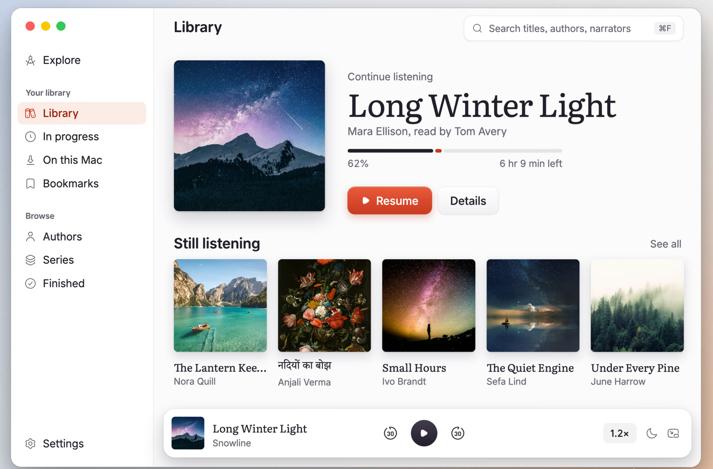
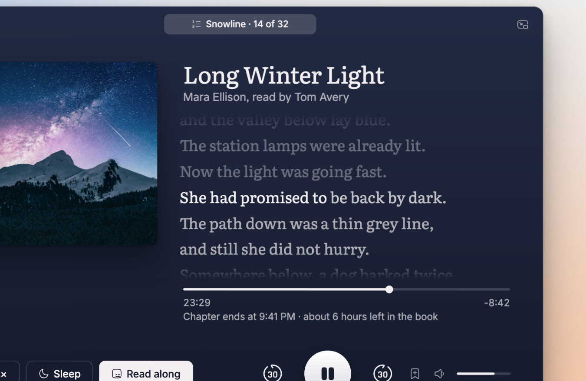
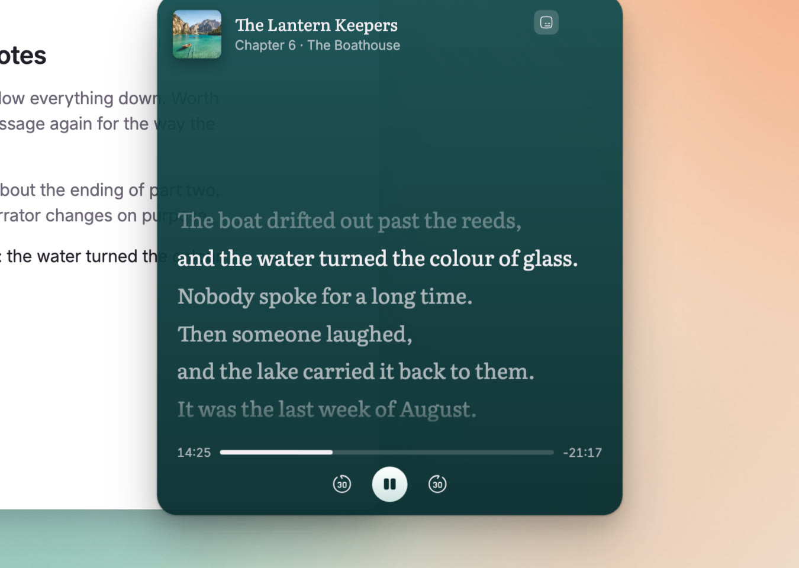
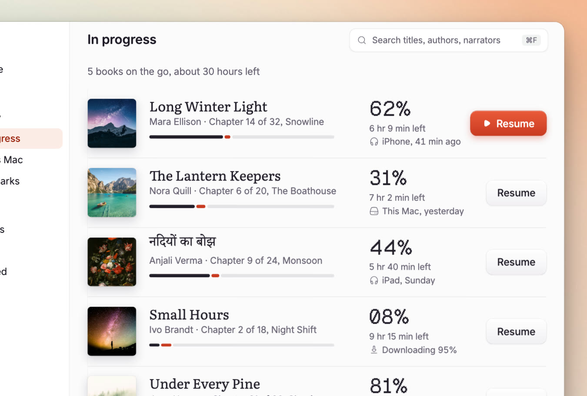

<p align="center">
  <picture>
    <source media="(prefers-color-scheme: dark)" srcset="docs/media/icon-dark.png">
    
  </picture>
</p>

<h1 align="center">Unabridged</h1>

<p align="center">
  A better Audible client for the Mac.<br>
  Your whole Audible library in a fast, native app.
</p>

<p align="center">
  <a href="#install">Install</a> ·
  <a href="#features">Features</a> ·
  <a href="#build-from-source">Build from source</a>
</p>

```sh
brew install --cask hk-vk/tap/unabridged
```

<p align="center">
  
</p>

On a Mac, Audible's app is its iPhone and iPad app. Unabridged is a real Mac app
for the Audible library you already own: offline downloads, a chapter-first
player, read along and a floating mini player, with your place synced to your
phone.

Free and open source. Needs a Mac with Apple silicon and macOS 14 or later.

## Features

**One-click sign-in with Amazon.** Pick your Audible store, sign in with Amazon
in your browser, and your whole library comes in. No passwords pass through
the app.

**A player built around the book.** Each book's player takes its colour from the
cover. Chapters, speeds from 0.75× to 2.5×, a sleep timer and bookmarks.

**Read along.** An on-device transcript follows the narration line by line.
Click a line you missed to jump back to it. Needs macOS 26.

**A mini player that floats.** Keep listening in a small window above your other
apps.

**See where you are.** Progress on every cover, and every book in progress with
what's left and where you last listened.

**Stream or download.** Play any book straight away, or download it to listen
offline. Either way, pick up where you left off on your phone.

<table>
  <tr>
    <td width="33%"></td>
    <td width="33%"></td>
    <td width="33%"></td>
  </tr>
  <tr>
    <td align="center">Read along</td>
    <td align="center">Mini player</td>
    <td align="center">In progress</td>
  </tr>
</table>

## Install

With [Homebrew](https://brew.sh), as above:

```sh
brew install --cask hk-vk/tap/unabridged
```

Or download the zip from [Releases](https://github.com/hk-vk/unabridged/releases)
and move Unabridged to Applications. It isn't notarized, so the first time you
open a downloaded copy, click **Open Anyway** in System Settings → Privacy &
Security. Updates install themselves after that.

## Privacy

Unabridged talks only to Amazon and Audible. There are no analytics and no
servers of ours. Your sign-in stays on your Mac, and read along transcribes on
your Mac too.

Downloads are unlocked with your own account's keys so they play offline. Use
it only for books you've bought.

## Build from source

```sh
cargo run -p better-audible    # needs rustup and Xcode 26 or later
```

Releases: [docs/releasing.md](docs/releasing.md).

## Acknowledgments

- [mkb79/Audible](https://github.com/mkb79/Audible) and
  [audible-cli](https://github.com/mkb79/audible-cli), the reference for how
  Audible's sign-in and API work.

## License

MIT or Apache-2.0, at your option. Bundled fonts, icons and libraries keep
their own licenses; see [THIRD-PARTY.md](THIRD-PARTY.md).

<sub>Not made, endorsed or supported by Audible or Amazon. "Audible" is a
trademark of Audible, Inc. Books shown are made up.</sub>
